<h1 align="center">Olá, eu sou o Lucas Bonfim 👋</h1>

  <strong>Desenvolvimento de software · Integrações · Qualidade</strong> 
  Java e sistemas orientados a eventos no trabalho. Aplicações web e automação nos meus projetos.

  
  
  

---

### 👨‍💻 Sobre mim

Sou graduando em **Sistemas de Informação no CEFET/RJ** e estagiário de **QA e DevOps na PGE/RJ**. Minha experiência reúne desenvolvimento de integrações, investigação de bugs, validação de dados e testes de software.

No trabalho, atuo com **Java, Apache Kafka, Quarkus e Apache Camel**, além de SQL e fluxos baseados em CDC. Nos projetos pessoais e como freelancer, desenvolvo aplicações com **React, Node.js e PostgreSQL**, do backend à interface.

- 🎓 Conclusão da graduação prevista para **dezembro de 2026** · CR **8,5**.
- 📚 Experiência em monitoria de **Linguagem de Programação (C)** e **Geometria Analítica**.
- 🧪 Vivência com testes manuais, exploratórios, de API e E2E, usando **Postman, Playwright e Cucumber**.
- 🔎 Gosto de entender o problema, investigar a causa e validar a solução com código, dados e testes.
- 🌌 Fora do código, também me interesso por astronomia e inovação.

### ⚙️ O que faço na prática

| Área | Experiência |
| :--- | :--- |
| **Integrações e backend** | APIs REST, consumo de eventos Kafka e sincronização de dados entre sistemas com Java, Quarkus e Apache Camel. |
| **Qualidade de software** | Cenários de teste, automação, investigação e reteste de defeitos, validação de regras de negócio e prevenção de regressões. |
| **Dados** | Consultas e scripts SQL para diagnóstico de inconsistências, cargas completas e incrementais e conferência de dados. |
| **Desenvolvimento web** | Aplicações com React, Node.js/Express e NestJS, autenticação, persistência e integração de APIs. |

### 🛠️ Tecnologias e ferramentas

**Linguagens**

  
  
  
  
  

**Backend e integrações**

  
  
  
  
  
  

**Frontend**

  
  
  

**Bancos de dados**

  
  
  

**Qualidade e ambiente de desenvolvimento**

  
  
  
  
  
  

### 🚀 Projetos em destaque

| Projeto | O que construí | Tecnologias | Conheça |
| :--- | :--- | :--- | :--- |
| **💰 Grana Control** | Sistema de controle financeiro com contas, transações, cartões, faturas, recorrências e exportações. | React, Vite, Tailwind CSS, Node.js, Express, PostgreSQL e Knex | [Aplicação](https://grana-control.lucasbonfimdev.com.br) · [Detalhes](https://www.lucasbonfimdev.com.br/projetos/grana-control) |
| **⛪ Casa Church** | Plataforma web com site público, autenticação e área administrativa para gestão de conteúdos e eventos. | React, NestJS, TypeScript, PostgreSQL e Sequelize | [Aplicação](https://casa-church.lucasbonfimdev.com.br) · [Detalhes](https://www.lucasbonfimdev.com.br/projetos/casa-church) |
| **✈️ Vai&Volta Viagens** | Sistema acadêmico de viagens com cadastros, vendas, relatórios, banco de dados e testes automatizados. | Java e SQL | [Código](https://github.com/lucaasbonfim/vvv) |
| **🧠 AI Meeting Assistant** | Geração de atas de reunião em PDF a partir de vídeos, com transcrição e resumo por IA. | Python, Streamlit, Whisper e Gemini | [Código](https://github.com/lucaasbonfim/ai-meeting-assistant) |

➡️ Veja mais projetos, demonstrações e estudos de caso no meu **[portfólio](https://www.lucasbonfimdev.com.br/projetos)**.

### 📊 Atividade no GitHub

  <a href="https://github.com/lucaasbonfim?tab=repositories">
    <picture>
      <source media="(prefers-color-scheme: dark)" srcset="https://github-stats-extended.vercel.app/api?username=lucaasbonfim&show_icons=true&hide_rank=true&theme=dark_github&locale=pt-br&hide_border=true&disable_animations=true">
      
    </picture>
    <picture>
      <source media="(prefers-color-scheme: dark)" srcset="https://github-stats-extended.vercel.app/api/top-langs/?username=lucaasbonfim&layout=compact&langs_count=6&theme=dark_github&locale=pt-br&hide_border=true&disable_animations=true">
      
    </picture>
  </a>

As métricas refletem os repositórios públicos; as linguagens representam a distribuição de código, não o nível de domínio.

### 👾 Game Zone · Pac-Man

Minhas contribuições no GitHub viraram um mapa para o Pac-Man. 🟡

<picture>
  <source media="(prefers-color-scheme: dark)" srcset="assets/pacman-contribution-graph-dark.svg">
  
</picture>

---

  <strong>Vamos conversar sobre desenvolvimento, qualidade ou seu próximo projeto?</strong> 
  <a href="https://www.linkedin.com/in/lucaasbonfim">LinkedIn</a> ·
  <a href="mailto:lucascardoso2103@gmail.com">E-mail</a> ·
  <a href="https://www.lucasbonfimdev.com.br">Portfólio</a>

